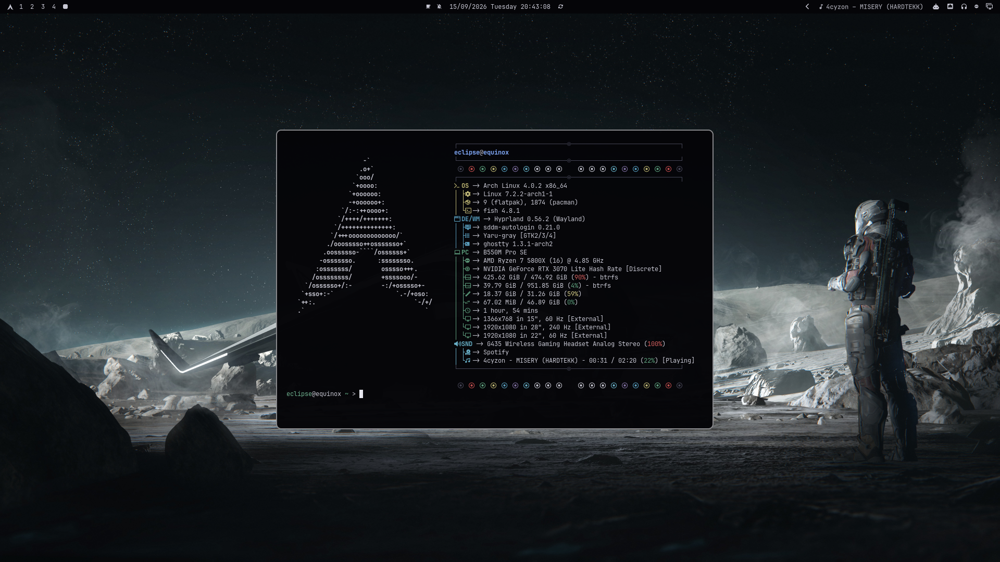
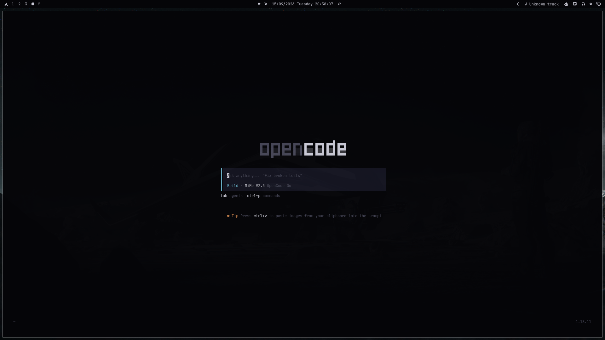
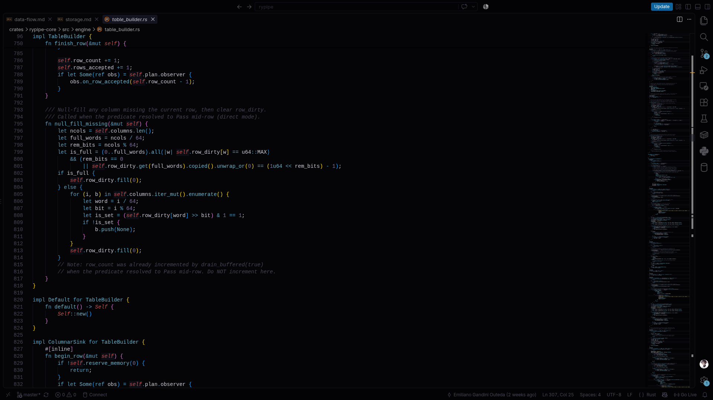
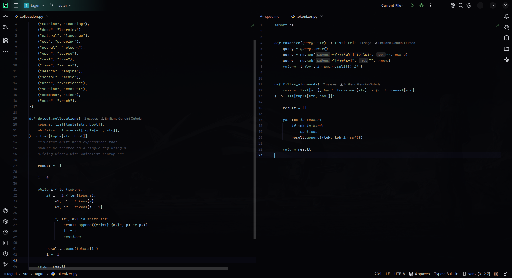

# Titan

> "Rice" in Spanish is "arroz". This is my rice ("arroz" in Spanish).

Two themes with cool sci-fi accents for Hyprland, Quickshell, opencode, VS Code, and PyCharm:

- **Titan Black** — Vanta Black-based dark theme, inspired by deep space imagery: near-black backgrounds with teal/cyan ambient glow and warm highlights.
- **Titan Light** — daylight counterpart with soft grey surfaces and the same teal accent.


## Apps

| App | Directory | Install |
|-----|-----------|---------|
| **Hyprland** | `hyprland/themes/titan-black/`, `hyprland/themes/titan-light/` | Copy wallpaper to `~/.config/hypr/wallpapers/` and add colors to `hyprland.conf` (see below) |
| **opencode** | `opencode/themes/` | Copy `titan-black.json` to `~/.config/opencode/themes/` and set `"theme": "titan-black"` in `tui.json` |
| **VS Code** | `vscode-titan-black/` | `code --install-extension vscode-titan-black/titan-black.vsix` |
| **PyCharm** | `pycharm/titan-black.jar` | Settings → Plugins → Install Plugin from Disk → select `titan-black.jar` |
| **Quickshell** | `quickshell/` | Copy config and plugins (see below) |

## Color Palette

### Titan Black

| Role | Hex | |
|------|-----|-|
| Background | `#050508` |  |
| Dark BG | `#080810` |  |
| Selection | `#1a1a2a` |  |
| Muted | `#454555` |  |
| Foreground | `#c8c8d4` |  |
| Accent (teal) | `#5a9ebf` |  |
| Cyan | `#6ab0c8` |  |
| Green | `#60a080` |  |
| Red | `#c05050` |  |
| Orange | `#b87848` |  |
| Yellow | `#c0b878` |  |
| Purple | `#8070a0` |  |

### Titan Light

| Role | Hex | |
|------|-----|-|
| Background | `#f4f5f7` |  |
| Dark BG | `#e9eaef` |  |
| Selection | `#d7dce6` |  |
| Muted | `#8a8a99` |  |
| Foreground | `#23232e` |  |
| Accent (teal) | `#5a9ebf` |  |
| Cyan | `#2f8aa0` |  |
| Green | `#4f8a6a` |  |
| Red | `#b04040` |  |
| Orange | `#a05f2c` |  |
| Yellow | `#9a8a3a` |  |
| Purple | `#6a5a8a` |  |

## Quickshell

Config for the Omarchy Quickshell bar: `shell.json`, the `Ocr` core indicator, and the `eclipse.*` plugins it references (`cpu`, `mpris`, `pomodoro`).

```bash
cp quickshell/shell.json ~/.config/omarchy/shell.json
cp -r quickshell/plugins/. ~/.config/omarchy/plugins/
sudo cp -r quickshell/shell/plugins/. "$OMARCHY_PATH/shell/plugins/"
```

The theme's `shell.toml` ships inside `hyprland/themes/titan-black/` and styles the shell when Titan Black is active. Re-run the `sudo cp` after Omarchy updates, which overwrite `$OMARCHY_PATH/shell`.

## Screenshots

### Hyprland


Add to your `~/.config/hypr/hyprland.conf`:

```conf
# Titan Black colors
$bg = rgb(050508)
$bgDark = rgb(080810)
$border = rgb(141420)
$accent = rgb(5a9ebf)
$fg = rgb(c8c8d4)

general {
    col.active_border = $accent
    col.inactive_border = $border
    border_size = 2
    gaps_in = 4
    gaps_out = 8
}

decoration {
    col.shadow = $bgDark
    col.shadow_border = $border
}

windowrulev2 = opacity 0.95 0.90, class:.*
```

For Titan Light, use:

```conf
# Titan Light colors
$bg = rgb(f4f5f7)
$bgDark = rgb(e9eaef)
$border = rgb(dfe1e8)
$accent = rgb(5a9ebf)
$fg = rgb(23232e)
```

### opencode


### VS Code


### PyCharm

